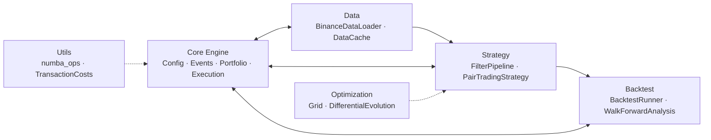

<picture>
  <source media="(prefers-color-scheme: dark)" srcset="docs/images/brand/wordmark-dark.svg">
  
</picture>

[English](README.md) | **한국어**

**백테스팅과 실거래를 통합한 이벤트 기반 암호화폐 페어 트레이딩(통계적 차익거래) 프레임워크.**

[](https://www.python.org/downloads/)
[](LICENSE)
[](https://www.linkedin.com/in/younghwan-chae/)

> 패키지 이름은 `quantbox`이며, 같은 이름의 [quantbox](https://github.com/younghwan91/quantbox) 레포(VR 스퀴즈 선물 시스템)와는 별개입니다. 교육 및 연구 목적의 프로젝트입니다.

- **이벤트 기반 일체형 엔진**: `MarketData → Signal → Order → Fill → Position` 파이프라인이 백테스트·페이퍼·실거래(`TradingMode`)에서 동일하게 동작합니다.
- **다단계 페어 필터링**: 상관계수, 공적분(Cointegration), Half-Life, Hurst 지수, ADF 정상성, 거래량 필터를 `FilterPipeline`으로 조합합니다.
- **Numba JIT 가속 & 비용 모델**: Rolling Z-Score, Half-Life, Hurst, OLS 헤지 비율을 Numba로 20~30배 가속하고 바이낸스 선물 수수료·슬리피지를 반영합니다.
- **Walk-Forward & 최적화**: Grid Search, Differential Evolution, 민감도 분석 및 Out-of-Sample 검증을 내장합니다.

---

## 설치 및 빠른 시작

```bash
git clone https://github.com/younghwan91/crypto-pair-trading.git
cd crypto-pair-trading

uv sync          # uv 권장 (Python 3.13+)
# 또는: pip install -e .
```

<details>
<summary>주요 의존성 보기</summary>

- Python 3.13+
- `numpy`, `pandas`, `scipy`, `statsmodels`
- `numba` (JIT 가속), `pykalman` (칼만 필터), `ta` (기술적 지표)
- `python-binance` (거래소 연동)

</details>

```python
from quantbox.data import BinanceDataLoader
from quantbox.strategy.filters import (
    FilterPipeline, CorrelationFilter, CointegrationFilter, HalfLifeFilter
)
from quantbox.backtest import BacktestRunner
from quantbox.core import Config

# 1. 데이터 다운로드
loader = BinanceDataLoader()
btc = loader.download("BTCUSDT", interval="1h", start_date="2024-01-01", end_date="2024-12-31")
eth = loader.download("ETHUSDT", interval="1h", start_date="2024-01-01", end_date="2024-12-31")

# 2. 페어 필터링
pipeline = FilterPipeline([
    CorrelationFilter(min_corr=0.7, max_corr=0.99),
    CointegrationFilter(max_pvalue=0.05),
    HalfLifeFilter(min_hl=5, max_hl=100),
])
result = pipeline.apply(btc["close"], eth["close"])
print(f"페어 적합성: {result.passed} (점수: {result.score:.2f})")

# 3. 백테스트 실행
config = Config(initial_capital=10000.0, entry_z_score=2.0, exit_z_score=0.5, trading_fee=0.0004)
runner = BacktestRunner(config)
results = runner.run({"BTCUSDT": btc, "ETHUSDT": eth})
print(results.metrics.summary())
```

### API 키 설정 (실거래용)

API 키는 코드나 설정 파일에 넣지 않고 환경변수로만 읽습니다. 백테스트는 키 없이 동작하며, 실거래(`TradingMode.LIVE`, `LiveExecutionHandler`)는 키가 없으면 시작을 거부합니다.

```bash
cp .env.example .env   # BINANCE_API_KEY, BINANCE_API_SECRET, BINANCE_TESTNET=true 설정 (.env는 gitignored)
set -a; . ./.env; set +a
```

---

## 아키텍처 개요



**이벤트 흐름:** `MarketData (가격 수신)` ➔ `Signal (신호 생성)` ➔ `Order (주문 생성)` ➔ `Fill (체결 처리)` ➔ `Position Update (포지션 갱신)`

---

## 모듈별 상세 가이드

| 모듈 | 역할 | 핵심 클래스 / 함수 |
|---|---|---|
| `quantbox.core` | 설정, 이벤트, 포트폴리오, 주문 실행 | `Config`, `Portfolio`, `SignalEvent`, `BacktestExecutionHandler`, `LiveExecutionHandler` |
| `quantbox.data` | 바이낸스 데이터 수집 및 2단계 캐시 | `BinanceDataLoader`, `DataCache`, `CacheConfig` |
| `quantbox.strategy` | 페어 필터링 및 Z-Score 전략 | `FilterPipeline`, `PairTradingStrategy` |
| `quantbox.backtest` | 백테스트 실행, 성과 지표, WFA | `BacktestRunner`, `calculate_metrics`, `WalkForwardAnalysis` |
| `quantbox.optimization` | 파라미터 최적화 및 민감도 분석 | `GridSearchOptimizer`, `DifferentialEvolutionOptimizer`, `SensitivityAnalysis` |
| `quantbox.utils` | Numba JIT 연산 및 거래 비용 모델 | `calculate_rolling_zscore`, `ols_hedge_ratio`, `TransactionCosts` |

<details>
<summary>1. Core 모듈 — Config, Events, Portfolio, Execution</summary>

#### 1.1 Config (설정 관리)

```python
from quantbox.core import Config, StrategyConfig, TradingMode

config = Config(
    mode=TradingMode.BACKTEST,      # BACKTEST, PAPER, LIVE
    initial_capital=10000.0,        # 초기 자본금 (USDT)
    trading_fee=0.0004,             # 거래 수수료 (0.04%)
    slippage=0.001                  # 슬리피지 (0.1%)
)

strategy_config = StrategyConfig(
    entry_z_score=2.0,              # 진입 Z-Score 임계값
    exit_z_score=0.5,               # 청산 Z-Score 임계값
    stop_loss_z_score=3.5,          # 손절 Z-Score
    lookback_period=100,            # 룩백 기간 (봉 수)
    max_holding_period=168          # 최대 보유 기간 (시간)
)
```

| 파라미터 | 타입 | 기본값 | 설명 |
|---|---|---|---|
| `mode` | `TradingMode` | `BACKTEST` | 실행 모드 |
| `initial_capital` | `float` | `10000.0` | 초기 자본금 |
| `trading_fee` | `float` | `0.0004` | 거래 수수료 비율 |
| `slippage` | `float` | `0.001` | 슬리피지 비율 |
| `entry_z_score` | `float` | `2.0` | 진입 임계값 |
| `exit_z_score` | `float` | `0.5` | 청산 임계값 |

#### 1.2 Events (이벤트 시스템)

```python
from quantbox.core.events import (
    SignalEvent, OrderEvent, FillEvent,
    SignalType, OrderSide, OrderType
)

signal = SignalEvent(
    symbol1="BTCUSDT",
    symbol2="ETHUSDT",
    signal_type=SignalType.LONG,    # LONG, SHORT, EXIT
    z_score=2.5,
    hedge_ratio=0.5,
    strength=0.83
)

order = OrderEvent(
    symbol="BTCUSDT",
    side=OrderSide.BUY,
    order_type=OrderType.MARKET,
    quantity=0.1
)

fill = FillEvent(
    symbol="BTCUSDT",
    side=OrderSide.BUY,
    fill_quantity=0.1,
    fill_price=50000.0,
    commission=2.0
)
```

| 이벤트 | 설명 | 주요 필드 |
|---|---|---|
| `SignalEvent` | 트레이딩 신호 | `symbol1`, `symbol2`, `signal_type`, `z_score` |
| `OrderEvent` | 주문 요청 | `symbol`, `side`, `quantity`, `order_type` |
| `FillEvent` | 체결 결과 | `fill_price`, `fill_quantity`, `commission` |
| `PositionEvent` | 포지션 변경 | `symbol`, `quantity`, `entry_price` |

#### 1.3 Portfolio (포트폴리오 관리)

```python
from quantbox.core.portfolio import Portfolio
from quantbox.core.events import FillEvent, OrderSide

portfolio = Portfolio(initial_capital=100000.0)
portfolio.process_fill(FillEvent(
    symbol="BTCUSDT", side=OrderSide.BUY,
    fill_quantity=0.5, fill_price=50000.0, commission=10.0
))

for symbol, pos in portfolio.positions.items():
    print(f"{symbol}: {pos.quantity} @ ${pos.avg_entry_price:,.0f} (미실현: ${pos.unrealized_pnl:+,.0f})")

print(f"총 자산: ${portfolio.total_equity:,.0f}, 드로다운: {portfolio.current_drawdown*100:.2f}%")
```

- **주요 메서드**: `process_fill(fill)`, `update_prices(prices)`, `get_position(symbol)`, `record_snapshot()`, `get_performance_metrics()`
- **Position 속성**: `quantity`, `avg_entry_price`, `market_value`, `unrealized_pnl`, `realized_pnl`, `is_long` / `is_short`

#### 1.4 Execution (주문 실행)

```python
from quantbox.core.execution import BacktestExecutionHandler, LiveExecutionHandler

backtest_exec = BacktestExecutionHandler(trading_fee=0.0004, slippage=0.001)
fill = backtest_exec.execute_order(order, current_price=50000.0)

# 실거래 핸들러: BINANCE_API_KEY / BINANCE_API_SECRET 미설정 시 RuntimeError 발생
live_exec = LiveExecutionHandler(config)
```

</details>

<details>
<summary>2. Data 모듈 — BinanceDataLoader, DataCache</summary>

```python
from quantbox.data import BinanceDataLoader
from quantbox.data.cache import DataCache, CacheConfig

loader = BinanceDataLoader()
btc = loader.download(symbol="BTCUSDT", interval="1h", start_date="2024-01-01", end_date="2024-12-31")
data = loader.download_multiple(symbols=["BTCUSDT", "ETHUSDT", "BNBUSDT", "SOLUSDT"], interval="1h", days=90)

# 2단계 캐시 (메모리 LRU + 디스크 압축)
cache = DataCache(CacheConfig(cache_dir="./data/cache", memory_cache_size=100, compression=True, ttl_hours=24))
cache.set("BTCUSDT_1h", btc)
cached = cache.get("BTCUSDT_1h")
print(f"히트율: {cache.get_stats()['hit_rate']:.1%}")
```

반환 데이터 컬럼: `open`, `high`, `low`, `close`, `volume` (`float`).

</details>

<details>
<summary>3. Strategy 모듈 — Filters, FilterPipeline, PairTradingStrategy</summary>

| 필터 | 목적 | 통과 조건 |
|---|---|---|
| `CorrelationFilter` | 상관관계 확인 | `min_corr <= r <= max_corr` |
| `CointegrationFilter` | 공적분 검정 | `p-value < max_pvalue` |
| `HalfLifeFilter` | 평균회귀 속도 | `min_hl <= HL <= max_hl` |
| `HurstFilter` | 시계열 특성 | `H < max_hurst` (0.5 미만: 평균회귀) |
| `StationarityFilter` | ADF 정상성 검정 | `p-value < threshold` |
| `VolumeFilter` | 최소 거래량 | `volume >= min_volume` |

```python
from quantbox.strategy import PairTradingStrategy
from quantbox.strategy.filters import (
    CorrelationFilter, CointegrationFilter, HalfLifeFilter, HurstFilter, FilterPipeline
)
from quantbox.core import Config

pipeline = FilterPipeline([
    CorrelationFilter(min_corr=0.5, max_corr=0.99),
    CointegrationFilter(max_pvalue=0.05),
    HalfLifeFilter(min_hl=5, max_hl=100),
    HurstFilter(max_hurst=0.5),
])
filter_res = pipeline.apply(btc_prices, eth_prices)

strategy = PairTradingStrategy(Config(entry_z_score=2.0, exit_z_score=0.5, stop_loss_z_score=3.5, lookback_period=100))
signal = strategy.generate_signal(price1=btc_prices, price2=eth_prices, hedge_ratio=0.5)
```

| Z-Score | 신호 | 동작 |
|---|---|---|
| `Z > entry` | `SHORT` | 스프레드 숏 (A 매도, B 매수) |
| `Z < -entry` | `LONG` | 스프레드 롱 (A 매수, B 매도) |
| `abs(Z) < exit` | `EXIT` | 포지션 청산 |
| `abs(Z) > stop_loss` | `EXIT` | 손절 청산 |

</details>

<details>
<summary>4. Backtest 모듈 — BacktestRunner, PerformanceMetrics, WalkForwardAnalysis</summary>

```python
from quantbox.backtest import BacktestRunner, BacktestConfig, WalkForwardAnalysis
from quantbox.backtest.metrics import calculate_metrics

config = BacktestConfig(initial_capital=10000.0, trading_fee=0.0004, slippage=0.001, entry_z_score=2.0, exit_z_score=0.5)
results = BacktestRunner(config).run(data)
print(results.metrics.summary())

metrics = calculate_metrics(equity_curve=equity_df, trades=trade_list, initial_capital=10000.0, risk_free_rate=0.05)

wfa = WalkForwardAnalysis(train_periods=500, test_periods=100, step_periods=50, n_folds=10)
wfa_res = wfa.run(data=data, strategy=strategy, param_ranges={"entry_z_score": (1.5, 3.0), "exit_z_score": (0.2, 1.0)})
print(f"효율성 비율 (OOS/IS): {wfa_res['efficiency_ratio']:.2f}")
```

**주요 성과 지표**: `total_return_pct`, `annualized_return`, `sharpe_ratio`, `sortino_ratio`, `calmar_ratio`, `max_drawdown`, `win_rate`, `profit_factor`.

</details>

<details>
<summary>5. Optimization 모듈 — GridSearch, DifferentialEvolution, SensitivityAnalysis</summary>

```python
from quantbox.optimization import GridSearchOptimizer, DifferentialEvolutionOptimizer, SensitivityAnalysis

grid_res = GridSearchOptimizer().optimize(
    data=data,
    strategy_class=PairTradingStrategy,
    param_grid={"entry_z_score": [1.5, 2.0, 2.5, 3.0], "exit_z_score": [0.25, 0.5, 0.75], "lookback_period": [50, 100, 150]},
    objective="sharpe_ratio",
)

de_res = DifferentialEvolutionOptimizer(population_size=15, max_iterations=50).optimize(
    data=data,
    strategy_class=PairTradingStrategy,
    param_bounds={"entry_z_score": (1.5, 3.5), "exit_z_score": (0.1, 1.0), "stop_loss_z_score": (2.5, 4.5)},
    objective="sharpe_ratio",
)

sens = SensitivityAnalysis().analyze(
    data=data, strategy=strategy, base_params=grid_res.best_params,
    param_ranges={"entry_z_score": (-0.5, 0.5, 0.1), "exit_z_score": (-0.3, 0.3, 0.1)},
)
```

</details>

<details>
<summary>6. Utils 모듈 — Numba JIT 연산 & 거래 비용 모델</summary>

```python
from quantbox.utils.numba_ops import (
    calculate_rolling_zscore, calculate_half_life, calculate_hurst_exponent,
    ols_hedge_ratio, optimal_position_sizing, kelly_criterion
)
from quantbox.utils.costs import create_binance_futures_costs

hedge_ratio = ols_hedge_ratio(prices1, prices2)
spread = prices1 - hedge_ratio * prices2
z_scores = calculate_rolling_zscore(spread, window=100)  # 순수 Python 대비 ~30x 가속
half_life = calculate_half_life(spread)                  # ~27x 가속
hurst = calculate_hurst_exponent(spread)                 # ~21x 가속

costs = create_binance_futures_costs()
cost = costs.calculate_total_cost(price=50000.0, quantity=0.1, is_buy=True, is_maker=False, volume=100_000_000)
roundtrip = costs.estimate_roundtrip_cost(entry_price=50000.0, quantity=0.1, is_maker=False, volume=100_000_000, expected_holding_8h=3)
```

</details>

---

## 테스트 및 프로젝트 구조

```bash
pytest tests/ -v                                      # 전체 테스트 실행
pytest tests/test_filters.py tests/test_portfolio.py  # 특정 모듈 테스트
pytest tests/ --cov=quantbox --cov-report=html        # 커버리지 리포트
```

<details>
<summary>디렉토리 구조 보기</summary>

```text
crypto-pair-trading/
├── quantbox/
│   ├── core/             # config, events, portfolio, execution, engine
│   ├── data/             # downloader, cache
│   ├── strategy/         # filters, pair_strategy, pair_selector
│   ├── backtest/         # runner, metrics, analyzer, walk_forward
│   ├── optimization/     # optimizer, objective, sensitivity
│   ├── utils/            # numba_ops, costs
│   ├── ui/               # 대시보드
│   └── examples/         # basic_usage.py
├── tests/                # 유닛 테스트
├── .env.example          # API 키 환경변수 틀 (값은 .env에, 커밋 금지)
└── pyproject.toml
```

</details>

## 라이선스 및 면책 조항

[MIT](LICENSE) © 2026 Younghwan Chae

이 소프트웨어는 **교육 및 연구 목적**으로만 사용해야 합니다.
- 암호화폐 거래는 원금 손실 위험이 있습니다.
- 백테스트 결과가 미래 수익을 보장하지 않습니다.
- 실거래 전 충분한 테스트와 검증이 필요하며, 투자 결정에 대한 책임은 사용자에게 있습니다.
