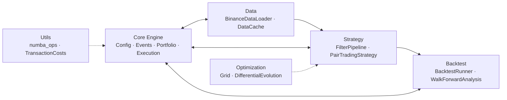

<picture>
  <source media="(prefers-color-scheme: dark)" srcset="docs/images/brand/wordmark-dark.svg">
  
</picture>

**English** | [한국어](README.ko.md)

**Event-driven crypto pair trading (statistical arbitrage) framework unifying backtesting and live execution.**

[](https://www.python.org/downloads/)
[](LICENSE)
[](https://www.linkedin.com/in/younghwan-chae/)

> The package name is `quantbox`, which is separate from the [quantbox](https://github.com/younghwan91/quantbox) repository (VR Squeeze futures system) of the same name. This project is for educational and research purposes.

- **Unified Event-Driven Engine**: The `MarketData → Signal → Order → Fill → Position` pipeline runs identically across backtest, paper, and live (`TradingMode`) execution.
- **Multi-Stage Pair Filtering**: Combine correlation, cointegration, half-life, Hurst exponent, ADF stationarity, and volume filters via `FilterPipeline`.
- **Numba JIT Acceleration & Cost Modeling**: Rolling Z-Score, half-life, Hurst, and OLS hedge ratio are accelerated 20–30x with Numba, incorporating Binance futures fees and slippage.
- **Walk-Forward & Optimization**: Built-in Grid Search, Differential Evolution, sensitivity analysis, and out-of-sample validation.

---

## Installation & Quick Start

```bash
git clone https://github.com/younghwan91/crypto-pair-trading.git
cd crypto-pair-trading

uv sync          # uv recommended (Python 3.13+)
# or: pip install -e .
```

<details>
<summary>View Key Dependencies</summary>

- Python 3.13+
- `numpy`, `pandas`, `scipy`, `statsmodels`
- `numba` (JIT acceleration), `pykalman` (Kalman filter), `ta` (technical indicators)
- `python-binance` (exchange integration)

</details>

```python
from quantbox.data import BinanceDataLoader
from quantbox.strategy.filters import (
    FilterPipeline, CorrelationFilter, CointegrationFilter, HalfLifeFilter
)
from quantbox.backtest import BacktestRunner
from quantbox.core import Config

# 1. Download data
loader = BinanceDataLoader()
btc = loader.download("BTCUSDT", interval="1h", start_date="2024-01-01", end_date="2024-12-31")
eth = loader.download("ETHUSDT", interval="1h", start_date="2024-01-01", end_date="2024-12-31")

# 2. Filter pairs
pipeline = FilterPipeline([
    CorrelationFilter(min_corr=0.7, max_corr=0.99),
    CointegrationFilter(max_pvalue=0.05),
    HalfLifeFilter(min_hl=5, max_hl=100),
])
result = pipeline.apply(btc["close"], eth["close"])
print(f"Pair passed: {result.passed} (score: {result.score:.2f})")

# 3. Run backtest
config = Config(initial_capital=10000.0, entry_z_score=2.0, exit_z_score=0.5, trading_fee=0.0004)
runner = BacktestRunner(config)
results = runner.run({"BTCUSDT": btc, "ETHUSDT": eth})
print(results.metrics.summary())
```

### API Key Setup (for Live Trading)

API keys are never placed in code or config files and are read exclusively from environment variables. Backtesting works without keys, while live trading (`TradingMode.LIVE`, `LiveExecutionHandler`) refuses to start if keys are missing.

```bash
cp .env.example .env   # Set BINANCE_API_KEY, BINANCE_API_SECRET, BINANCE_TESTNET=true (.env is gitignored)
set -a; . ./.env; set +a
```

---

## Architecture Overview



**Event Flow:** `MarketData` ➔ `Signal` ➔ `Order` ➔ `Fill` ➔ `Position Update`

---

## Module Guide

| Module | Role | Key Classes / Functions |
|---|---|---|
| `quantbox.core` | Config, events, portfolio, order execution | `Config`, `Portfolio`, `SignalEvent`, `BacktestExecutionHandler`, `LiveExecutionHandler` |
| `quantbox.data` | Binance data ingestion & 2-tier cache | `BinanceDataLoader`, `DataCache`, `CacheConfig` |
| `quantbox.strategy` | Pair filtering & Z-Score strategy | `FilterPipeline`, `PairTradingStrategy` |
| `quantbox.backtest` | Backtest runner, performance metrics, WFA | `BacktestRunner`, `calculate_metrics`, `WalkForwardAnalysis` |
| `quantbox.optimization` | Parameter optimization & sensitivity analysis | `GridSearchOptimizer`, `DifferentialEvolutionOptimizer`, `SensitivityAnalysis` |
| `quantbox.utils` | Numba JIT ops & transaction cost model | `calculate_rolling_zscore`, `ols_hedge_ratio`, `TransactionCosts` |

<details>
<summary>1. Core Module — Config, Events, Portfolio, Execution</summary>

#### 1.1 Config

```python
from quantbox.core import Config, StrategyConfig, TradingMode

config = Config(
    mode=TradingMode.BACKTEST,      # BACKTEST, PAPER, LIVE
    initial_capital=10000.0,        # Initial capital (USDT)
    trading_fee=0.0004,             # Trading fee (0.04%)
    slippage=0.001                  # Slippage (0.1%)
)

strategy_config = StrategyConfig(
    entry_z_score=2.0,              # Entry Z-Score threshold
    exit_z_score=0.5,               # Exit Z-Score threshold
    stop_loss_z_score=3.5,          # Stop-loss Z-Score
    lookback_period=100,            # Lookback period (bars)
    max_holding_period=168          # Max holding period (hours)
)
```

| Parameter | Type | Default | Description |
|---|---|---|---|
| `mode` | `TradingMode` | `BACKTEST` | Execution mode |
| `initial_capital` | `float` | `10000.0` | Initial capital |
| `trading_fee` | `float` | `0.0004` | Trading fee rate |
| `slippage` | `float` | `0.001` | Slippage rate |
| `entry_z_score` | `float` | `2.0` | Entry threshold |
| `exit_z_score` | `float` | `0.5` | Exit threshold |

#### 1.2 Events

```python
from quantbox.core.events import (
    SignalEvent, OrderEvent, FillEvent,
    SignalType, OrderSide, OrderType
)

signal = SignalEvent(
    symbol1="BTCUSDT",
    symbol2="ETHUSDT",
    signal_type=SignalType.LONG,    # LONG, SHORT, EXIT
    z_score=2.5,
    hedge_ratio=0.5,
    strength=0.83
)

order = OrderEvent(
    symbol="BTCUSDT",
    side=OrderSide.BUY,
    order_type=OrderType.MARKET,
    quantity=0.1
)

fill = FillEvent(
    symbol="BTCUSDT",
    side=OrderSide.BUY,
    fill_quantity=0.1,
    fill_price=50000.0,
    commission=2.0
)
```

| Event | Description | Key Fields |
|---|---|---|
| `SignalEvent` | Trading signal | `symbol1`, `symbol2`, `signal_type`, `z_score` |
| `OrderEvent` | Order request | `symbol`, `side`, `quantity`, `order_type` |
| `FillEvent` | Fill result | `fill_price`, `fill_quantity`, `commission` |
| `PositionEvent` | Position change | `symbol`, `quantity`, `entry_price` |

#### 1.3 Portfolio

```python
from quantbox.core.portfolio import Portfolio
from quantbox.core.events import FillEvent, OrderSide

portfolio = Portfolio(initial_capital=100000.0)
portfolio.process_fill(FillEvent(
    symbol="BTCUSDT", side=OrderSide.BUY,
    fill_quantity=0.5, fill_price=50000.0, commission=10.0
))

for symbol, pos in portfolio.positions.items():
    print(f"{symbol}: {pos.quantity} @ ${pos.avg_entry_price:,.0f} (Unrealized: ${pos.unrealized_pnl:+,.0f})")

print(f"Total Equity: ${portfolio.total_equity:,.0f}, Drawdown: {portfolio.current_drawdown*100:.2f}%")
```

- **Key Methods**: `process_fill(fill)`, `update_prices(prices)`, `get_position(symbol)`, `record_snapshot()`, `get_performance_metrics()`
- **Position Attributes**: `quantity`, `avg_entry_price`, `market_value`, `unrealized_pnl`, `realized_pnl`, `is_long` / `is_short`

#### 1.4 Execution

```python
from quantbox.core.execution import BacktestExecutionHandler, LiveExecutionHandler

backtest_exec = BacktestExecutionHandler(trading_fee=0.0004, slippage=0.001)
fill = backtest_exec.execute_order(order, current_price=50000.0)

# Live handler: raises RuntimeError if BINANCE_API_KEY / BINANCE_API_SECRET are not set
live_exec = LiveExecutionHandler(config)
```

</details>

<details>
<summary>2. Data Module — BinanceDataLoader, DataCache</summary>

```python
from quantbox.data import BinanceDataLoader
from quantbox.data.cache import DataCache, CacheConfig

loader = BinanceDataLoader()
btc = loader.download(symbol="BTCUSDT", interval="1h", start_date="2024-01-01", end_date="2024-12-31")
data = loader.download_multiple(symbols=["BTCUSDT", "ETHUSDT", "BNBUSDT", "SOLUSDT"], interval="1h", days=90)

# 2-tier cache (in-memory LRU + compressed disk)
cache = DataCache(CacheConfig(cache_dir="./data/cache", memory_cache_size=100, compression=True, ttl_hours=24))
cache.set("BTCUSDT_1h", btc)
cached = cache.get("BTCUSDT_1h")
print(f"Hit rate: {cache.get_stats()['hit_rate']:.1%}")
```

Returned columns: `open`, `high`, `low`, `close`, `volume` (`float`).

</details>

<details>
<summary>3. Strategy Module — Filters, FilterPipeline, PairTradingStrategy</summary>

| Filter | Purpose | Pass Condition |
|---|---|---|
| `CorrelationFilter` | Correlation check | `min_corr <= r <= max_corr` |
| `CointegrationFilter` | Cointegration test | `p-value < max_pvalue` |
| `HalfLifeFilter` | Mean-reversion speed | `min_hl <= HL <= max_hl` |
| `HurstFilter` | Time-series regime | `H < max_hurst` (< 0.5: mean-reverting) |
| `StationarityFilter` | ADF stationarity test | `p-value < threshold` |
| `VolumeFilter` | Minimum volume | `volume >= min_volume` |

```python
from quantbox.strategy import PairTradingStrategy
from quantbox.strategy.filters import (
    CorrelationFilter, CointegrationFilter, HalfLifeFilter, HurstFilter, FilterPipeline
)
from quantbox.core import Config

pipeline = FilterPipeline([
    CorrelationFilter(min_corr=0.5, max_corr=0.99),
    CointegrationFilter(max_pvalue=0.05),
    HalfLifeFilter(min_hl=5, max_hl=100),
    HurstFilter(max_hurst=0.5),
])
filter_res = pipeline.apply(btc_prices, eth_prices)

strategy = PairTradingStrategy(Config(entry_z_score=2.0, exit_z_score=0.5, stop_loss_z_score=3.5, lookback_period=100))
signal = strategy.generate_signal(price1=btc_prices, price2=eth_prices, hedge_ratio=0.5)
```

| Z-Score | Signal | Action |
|---|---|---|
| `Z > entry` | `SHORT` | Short spread (Sell A, Buy B) |
| `Z < -entry` | `LONG` | Long spread (Buy A, Sell B) |
| `abs(Z) < exit` | `EXIT` | Close position |
| `abs(Z) > stop_loss` | `EXIT` | Stop-loss exit |

</details>

<details>
<summary>4. Backtest Module — BacktestRunner, PerformanceMetrics, WalkForwardAnalysis</summary>

```python
from quantbox.backtest import BacktestRunner, BacktestConfig, WalkForwardAnalysis
from quantbox.backtest.metrics import calculate_metrics

config = BacktestConfig(initial_capital=10000.0, trading_fee=0.0004, slippage=0.001, entry_z_score=2.0, exit_z_score=0.5)
results = BacktestRunner(config).run(data)
print(results.metrics.summary())

metrics = calculate_metrics(equity_curve=equity_df, trades=trade_list, initial_capital=10000.0, risk_free_rate=0.05)

wfa = WalkForwardAnalysis(train_periods=500, test_periods=100, step_periods=50, n_folds=10)
wfa_res = wfa.run(data=data, strategy=strategy, param_ranges={"entry_z_score": (1.5, 3.0), "exit_z_score": (0.2, 1.0)})
print(f"Efficiency Ratio (OOS/IS): {wfa_res['efficiency_ratio']:.2f}")
```

**Key Performance Metrics**: `total_return_pct`, `annualized_return`, `sharpe_ratio`, `sortino_ratio`, `calmar_ratio`, `max_drawdown`, `win_rate`, `profit_factor`.

</details>

<details>
<summary>5. Optimization Module — GridSearch, DifferentialEvolution, SensitivityAnalysis</summary>

```python
from quantbox.optimization import GridSearchOptimizer, DifferentialEvolutionOptimizer, SensitivityAnalysis

grid_res = GridSearchOptimizer().optimize(
    data=data,
    strategy_class=PairTradingStrategy,
    param_grid={"entry_z_score": [1.5, 2.0, 2.5, 3.0], "exit_z_score": [0.25, 0.5, 0.75], "lookback_period": [50, 100, 150]},
    objective="sharpe_ratio",
)

de_res = DifferentialEvolutionOptimizer(population_size=15, max_iterations=50).optimize(
    data=data,
    strategy_class=PairTradingStrategy,
    param_bounds={"entry_z_score": (1.5, 3.5), "exit_z_score": (0.1, 1.0), "stop_loss_z_score": (2.5, 4.5)},
    objective="sharpe_ratio",
)

sens = SensitivityAnalysis().analyze(
    data=data, strategy=strategy, base_params=grid_res.best_params,
    param_ranges={"entry_z_score": (-0.5, 0.5, 0.1), "exit_z_score": (-0.3, 0.3, 0.1)},
)
```

</details>

<details>
<summary>6. Utils Module — Numba JIT Ops & Transaction Cost Model</summary>

```python
from quantbox.utils.numba_ops import (
    calculate_rolling_zscore, calculate_half_life, calculate_hurst_exponent,
    ols_hedge_ratio, optimal_position_sizing, kelly_criterion
)
from quantbox.utils.costs import create_binance_futures_costs

hedge_ratio = ols_hedge_ratio(prices1, prices2)
spread = prices1 - hedge_ratio * prices2
z_scores = calculate_rolling_zscore(spread, window=100)  # ~30x faster than pure Python
half_life = calculate_half_life(spread)                  # ~27x faster
hurst = calculate_hurst_exponent(spread)                 # ~21x faster

costs = create_binance_futures_costs()
cost = costs.calculate_total_cost(price=50000.0, quantity=0.1, is_buy=True, is_maker=False, volume=100_000_000)
roundtrip = costs.estimate_roundtrip_cost(entry_price=50000.0, quantity=0.1, is_maker=False, volume=100_000_000, expected_holding_8h=3)
```

</details>

---

## Testing & Project Structure

```bash
pytest tests/ -v                                      # Run all tests
pytest tests/test_filters.py tests/test_portfolio.py  # Run specific module tests
pytest tests/ --cov=quantbox --cov-report=html        # Coverage report
```

<details>
<summary>View Directory Structure</summary>

```text
crypto-pair-trading/
├── quantbox/
│   ├── core/             # config, events, portfolio, execution, engine
│   ├── data/             # downloader, cache
│   ├── strategy/         # filters, pair_strategy, pair_selector
│   ├── backtest/         # runner, metrics, analyzer, walk_forward
│   ├── optimization/     # optimizer, objective, sensitivity
│   ├── utils/            # numba_ops, costs
│   ├── ui/               # dashboard
│   └── examples/         # basic_usage.py
├── tests/                # unit tests
├── .env.example          # API key env template (put values in .env, never commit)
└── pyproject.toml
```

</details>

## License & Disclaimer

[MIT](LICENSE) © 2026 Younghwan Chae

This software is intended for **educational and research purposes only**.
- Cryptocurrency trading carries risk of loss of principal.
- Backtest results do not guarantee future returns.
- Thorough testing and validation are required before live trading; all investment decisions are the sole responsibility of the user.
